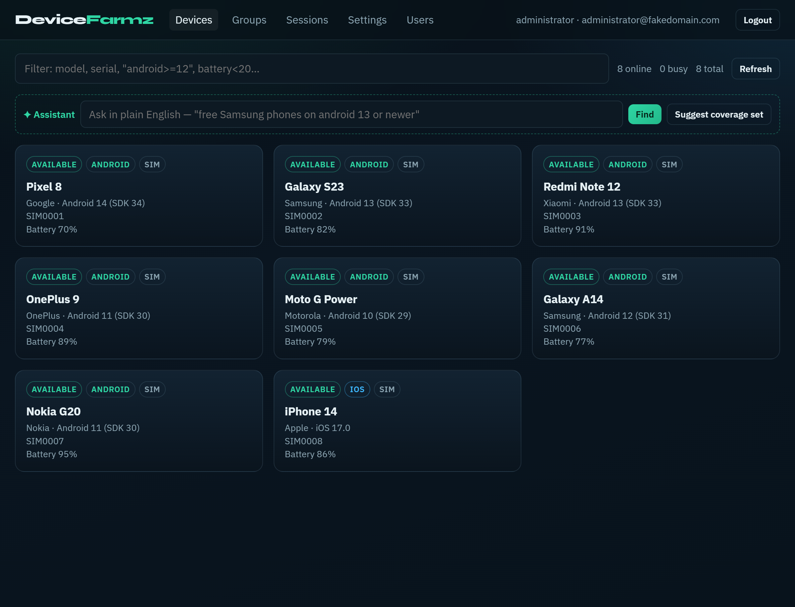
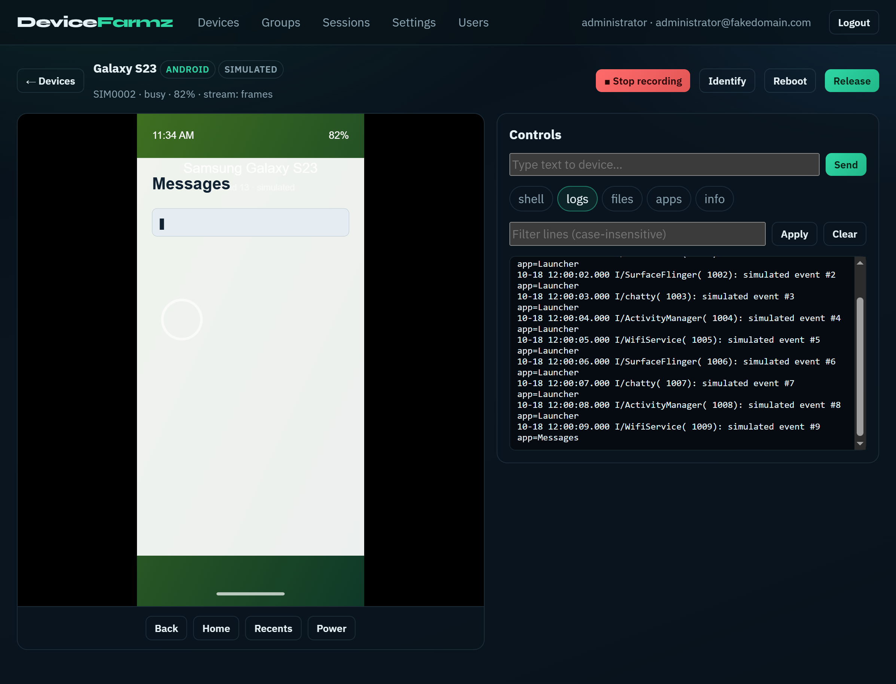
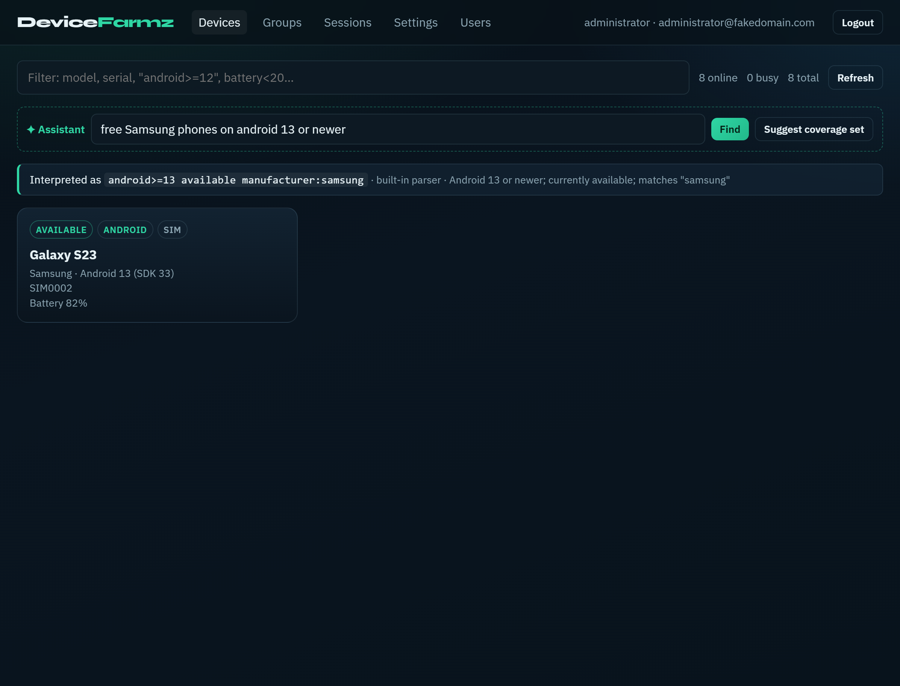

<div align="center">

# DeviceFarmz

**Turn a shelf of phones into a shared test lab.**
Control real devices from the browser, hand them to your CI and Appium, and get them wiped clean for the next person ? automatically.


[Quick start](#-quick-start-no-hardware-needed) � [Real devices](#-real-android-devices) � [CI & Appium](#-ci-and-appium) � [Configuration](#-configuration) � [?????](README.fa.md)



</div>

---

## Why

Phones in a drawer don't scale: people ask "who has the Pixel?", test runs leave personal data behind, and CI can't borrow a device. DeviceFarmz plugs your devices into one machine and gives everybody ? humans and pipelines ? a fair, clean, observable way to use them.

## Highlights

| | |
|---|---|
| ??? **Control from the browser** | Low-latency H.264 screen, touch, typing, Back/Home/Recents/Power, shell, logcat, file explorer, APK install, open URL, port forwarding |
| ?? **Built for automation** | Device leases over REST, an **Appium gateway**, API tokens, a `ci run` command that always releases the device |
| ?? **Clean between users** | On release the device is force-stopped, user apps are cleared (or uninstalled), media wiped ? and nobody can claim it until it's done |
| ?? **Session recording** | Video + device log for every session, playable in the UI |
| ?? **Real sign-in** | OpenID Connect (PKCE) and LDAP, with group ? admin mapping |
| ?? **Webhooks** | HMAC-signed events with retries and a delivery log |
| ? **Assistant** | "free Samsung phones on android 13 or newer" ? a device query; one click to suggest the smallest set of devices that covers the most OS versions, brands and screens |
| ?? **Built-in simulator** | `--fake 8` gives you virtual phones ? try everything (even the UI) with zero hardware |
| ?? **iOS (experimental)** | libimobiledevice + WebDriverAgent |

<table>
<tr>
<td width="50%"></td>
<td width="50%"></td>
</tr>
<tr>
<td align="center"><sub>Live screen, logs, shell and recording</sub></td>
<td align="center"><sub>Plain-language search</sub></td>
</tr>
</table>

## ? Quick start (no hardware needed)

```bash
git clone https://github.com/<your-user>/devicefarmz.git
cd devicefarmz
npm install
npm run build
npm run dev:demo        # hub on :7100, UI on :5173, 8 simulated devices
```

Open **http://localhost:5173** and use the development login. Click a device, tap on the screen, open the Logs tab, press **Record**.

Prefer one process serving the built UI? `node apps/server/dist/cli.js local --fake 8` ? http://localhost:7100.

## ?? Real Android devices

```bash
npm run setup:tools     # downloads adb into ./tools and the H.264 video server jar
npm run doctor          # checks Node, adb, attached devices and the video jar
npm run build
npm start               # http://localhost:7100
```

1. On each phone: **Developer options ? USB debugging**, and accept the RSA prompt.
2. Plug it into the machine that runs the hub (a powered USB hub is strongly recommended).
3. It appears in the UI within a few seconds.

Already have adb? Set `ADB_PATH` and skip the download. Without the video jar the hub falls back to screenshot streaming, which works everywhere but is slower. Install `ffmpeg` if you want recordings as mp4 instead of raw H.264.

## ?? CI and Appium

Create an **API token** in *Settings*, then run any command on a reserved device:

```bash
export DEVICEFARMZ_URL=https://farm.example.com
export DEVICEFARMZ_TOKEN=dfz_...

devicefarmz ci run --query "android>=13" --wait 120 --label "$BUILD_ID" -- ./gradlew connectedCheck
# DEVICE_UDID is set for your command; the device is released and wiped afterwards ? even if the command fails
```

Need separate steps? `devicefarmz ci acquire` prints `{ sessions, serials, leases }` (and writes GitHub step outputs), `devicefarmz ci release <session-ids?>` frees them. A ready-made workflow lives in [`examples/github-actions.yml`](examples/github-actions.yml).

### Appium

Run Appium (default `http://127.0.0.1:4723`, change with `DEVICEFARMZ_APPIUM_URL`) and point your client at the farm instead:

```js
const driver = await remote({
  hostname: 'farm.example.com', port: 7100, path: '/appium',
  user: 'ci', key: process.env.DEVICEFARMZ_TOKEN,
  capabilities: {
    platformName: 'Android',
    'appium:automationName': 'UiAutomator2',
    'devicefarmz:query': 'android>=13',   // optional: which device
    'devicefarmz:ttl': 1800,              // optional: lease seconds (extended on every command)
    'devicefarmz:waitSec': 60,            // optional: wait for a free device
  },
})
```

The hub reserves a matching device, injects its UDID, strips the `devicefarmz:*` capabilities, and releases the device when the session ends (or the lease expires).

### REST

```bash
curl -X POST https://farm.example.com/api/automation/sessions \
  -H "Authorization: Bearer $DEVICEFARMZ_TOKEN" -H "Content-Type: application/json" \
  -d '{"query":"samsung android>=12","count":2,"ttlSec":900,"waitSec":30}'
```

Heartbeat with `POST /api/automation/sessions/:id/heartbeat`, release with `DELETE /api/automation/sessions/:id`.

## ?? Query language

Used by the search box, automation leases, the CI helper and the Appium gateway:

```
android>=13            ios>=16            sdk>=33
manufacturer:samsung   model:pixel        platform:android
battery>50             battery<20         available   busy   offline
```

Whitespace means AND; any other word matches serial, model, manufacturer, owner and notes.

## ??? Security notes

- Set `DEVICEFARMZ_JWT_SECRET` to a long random value before exposing the hub to anyone.
- The development login is only enabled by default when **no** OIDC/LDAP provider is configured. Don't expose a hub with it on.
- Put the hub behind HTTPS (a reverse proxy is fine; WebSocket upgrade on `/ws` must be allowed).
- API tokens are stored as SHA-256 hashes and shown once. Webhook management is admin-only; payloads are signed with `X-DeviceFarmz-Signature: sha256=<hmac>`.
- Device operations require holding the device (or being an admin); group membership limits who can see what.
- Shell access means full control of the phone. Treat farm users as trusted for the devices they claim, and use `clean`/`uninstall` reset mode for shared labs.

## ?? Configuration

Settings come from environment variables, or from a `.env` file ([`.env.example`](.env.example)).

<details>
<summary><b>Hub, devices and recording</b></summary>

| Variable | Default | Meaning |
|---|---|---|
| `DEVICEFARMZ_PORT` | `7100` | Hub port |
| `DEVICEFARMZ_DATA` | `./data` | SQLite, uploads, recordings |
| `DEVICEFARMZ_JWT_SECRET` | dev secret | Session signing ? **change it** |
| `DEVICEFARMZ_PUBLIC_IP` / `_PUBLIC_URL` | `localhost` | Address advertised to clients |
| `DEVICEFARMZ_RESET_MODE` | `clean` | `none` \| `clean` \| `uninstall` on release |
| `DEVICEFARMZ_RELEASE_GRACE_MS` | `20000` | How long a device stays claimed after the browser disconnects |
| `DEVICEFARMZ_AUTO_RECORD` | `false` | Record every session |
| `DEVICEFARMZ_SCRCPY` | `true` | Use H.264 streaming when the jar exists |
| `DEVICEFARMZ_VIDEO_MAX_SIZE` / `_BITRATE` / `_MAX_FPS` | `1024` / `4000000` / `30` | Video quality |
| `DEVICEFARMZ_SCREEN_FPS` | `4` | Fallback screenshot FPS |
| `DEVICEFARMZ_FAKE_DEVICES` | `0` | Simulated devices |
| `DEVICEFARMZ_ANDROID` | `true` | Set `false` to run iOS/simulator only |
| `DEVICEFARMZ_IOS` | `false` | Enable the iOS provider |
| `DEVICEFARMZ_APPIUM_URL` | `http://127.0.0.1:4723` | Upstream Appium server |
| `ADB_PATH`, `FFMPEG_PATH` | auto | Tool locations |

</details>

<details>
<summary><b>Sign-in</b></summary>

| Variable | Meaning |
|---|---|
| `DEVICEFARMZ_OIDC_ISSUER`, `_CLIENT_ID`, `_CLIENT_SECRET`, `_REDIRECT_URI` | OpenID Connect. Redirect URI is `<hub>/api/auth/oidc/callback` |
| `DEVICEFARMZ_OIDC_SCOPES`, `_LABEL`, `_GROUP_CLAIM`, `_ADMIN_GROUP` | Scopes, button label, group claim, group that grants admin |
| `DEVICEFARMZ_OIDC_ALLOW_INSECURE` | Allow a plain-`http` issuer. Off by default; `localhost` is always allowed for development |
| `DEVICEFARMZ_LDAP_URL`, `_BIND_DN`, `_BIND_PASSWORD`, `_BASE_DN` | LDAP service account and search base |
| `DEVICEFARMZ_LDAP_USER_FILTER` | Default `(uid={{username}})` |
| `DEVICEFARMZ_LDAP_ADMIN_GROUP`, `_MAIL_ATTR`, `_NAME_ATTR` | Admin group DN, attribute mapping |
| `DEVICEFARMZ_MOCK_AUTH` | Force the development login on or off |

</details>

<details>
<summary><b>Assistant</b></summary>

By default the assistant uses a built-in rule-based parser. Point it at any OpenAI-compatible endpoint for free-form questions:

`DEVICEFARMZ_LLM_URL`, `DEVICEFARMZ_LLM_KEY`, `DEVICEFARMZ_LLM_MODEL` (default `gpt-4o-mini`). The model only ever produces a *query string*, which is validated before use.

</details>

## ?? Webhooks

Events: `device.online`, `device.offline`, `device.claimed`, `device.released`, `device.reset`, `automation.started`, `automation.ended`, `recording.started`, `recording.ready`, `webhook.test`.

Verify a delivery:

```js
const expected = 'sha256=' + crypto.createHmac('sha256', secret).update(rawBody).digest('hex')
const ok = crypto.timingSafeEqual(Buffer.from(expected), Buffer.from(req.headers['x-devicefarmz-signature']))
```

## ?? iOS (experimental)

Requires macOS or Linux with `libimobiledevice` (`idevice_id`, `ideviceinfo`, `ideviceinstaller`, `iproxy`) and WebDriverAgent that you have already built and can install on your devices. Set `DEVICEFARMZ_IOS=true`.

Supported: screen, tap/swipe, typing, Home, app install, open URL. Not supported on iOS: shell, file explorer, logcat, port forwarding.

## ??? Architecture

```
Browser ??HTTP/WS??? Hub (REST + WebSocket + static UI) ??? CI jobs / Appium clients
                      ?
                      ?? Providers ?? Android (ADB + video server) � iOS (WDA) � Simulator
                      ?? Lifecycle ?? claim ? use ? reset ? available
                      ?? Automation leases � Appium gateway � Recorder � Webhooks
                      ?? SQLite
```

```
packages/core    shared types, wire protocol, query language, assistant logic
apps/server      Express + ws + SQLite hub, providers, CLI
apps/web         React + Vite UI
scripts/         tool installer
examples/        CI examples
```

## ?? Development

```bash
npm run dev:demo   # hub + UI with simulated devices, hot reload
npm run typecheck
npm test           # unit tests + an end-to-end suite against a simulated fleet
npm run build
```

Docker: `docker compose up --build` (USB pass-through is host-specific; see the comments in `docker-compose.yml`).

## ?? Status and known limitations

1.0.0 is feature-complete. The whole flow is covered by automated tests against the simulator, and the device and login integrations are covered by protocol-level mocks (`npm test` runs all 41 tests with no hardware). Be aware that:

- Mocked, not field-tested: H.264 streaming (an in-process `adb` with a scrcpy-style video server), the iOS/WebDriverAgent provider (a WDA HTTP mock plus fake libimobiledevice tools), OIDC (a mock provider with PKCE, signed ID tokens and JWKS) and LDAP (a mock directory). These tests check that DeviceFarmz speaks the protocols correctly; they cannot prove that a particular phone, WebDriverAgent build or identity provider behaves identically ? please report anything you hit on real hardware or identity providers.
- Recordings of simulated devices contain logs only.
- Devices must be attached to the machine that runs the hub; remote `adb connect` providers are not available yet.

## ?? Contributing

Issues and pull requests are welcome. Please run `npm run typecheck && npm test` before opening a PR, and add a test for behavior changes.

## ?? License

[Apache-2.0](LICENSE). The optional video streaming uses the Apache-2.0 scrcpy server, downloaded by `npm run setup:tools`.
